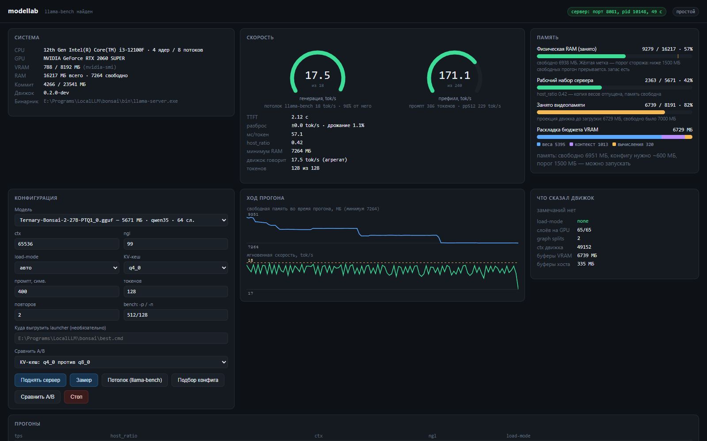
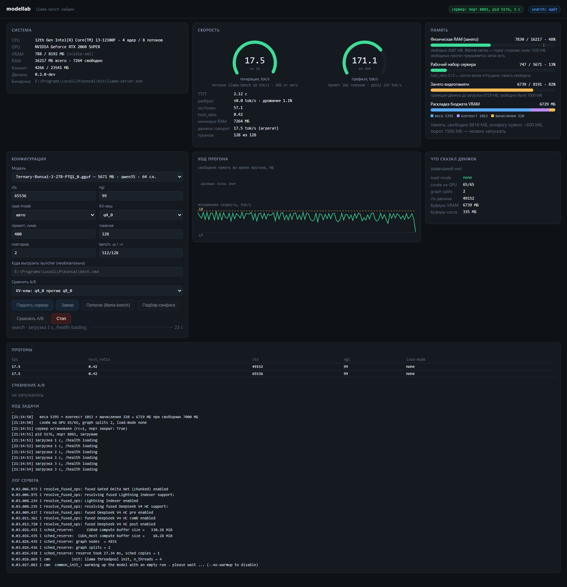

# ModelLab

Пульт для локальных LLM на слабом железе: измеряет скорость и память одним прогоном,
подбирает контекст, который влезает в видеопамять целиком, и сравнивает конфигурации
прогонами вперемешку - одиночное сравнение на такой машине измеряет шум, а не эффект.



Только стандартная библиотека Python 3.9+: интерфейс - один HTML-файл, который отдаёт
`http.server`. Браузерный рантайм на сотни мегабайт попал бы в тот же бюджет памяти,
который приложение измеряет; `http.server` со страницей стоят около 15 МБ.

## Требования

- **Python 3.9+**, без `pip install`
- **llama-server** из [llama.cpp](https://github.com/ggerganov/llama.cpp) или сборок
  LM Studio / Bionic - в `PATH`, в переменной `LLAMA_SERVER` или в известном месте
- **NVIDIA GPU** - VRAM читается через `nvidia-smi`
- каталог с GGUF-моделями

## Запуск

```
python -m modellab.gui                 # http://127.0.0.1:8090
python -m modellab.gui --open          # сразу открыть браузер
python -m modellab.gui --models D:\gguf --port 9000
```

Проверка модели на готовность к агентской работе - вторая половина репозитория:

```
python weds.py check      # полная диагностика одной командой
python weds.py doctor     # что вообще запущено
python weds.py tune       # подобрать параметры под железо (с бэкапом конфига)
python weds.py mcp        # MCP-сервер, чтобы звать это из любого агента
```



## Что делает

- **Потолок контекста аналитически.** Расход VRAM от контекста линеен, поэтому хватает
  двух загрузок на разных `ctx`, а не сетки по всем значениям: подбор занимает секунды
  вместо минут.
- **A/B прогонами вперемешку.** Одна и та же конфигурация в соседних прогонах давала
  8.12 и 15.38 tok/s - разброс берётся из окружения. Варианты чередуются, сравниваются
  разности внутри пар.
- **Память как первый класс.** Скорость и потребление меряются одним прогоном, режим
  загрузки выводится из числа слоёв.
- **Защита от «уронил машину».** `preflight` по свободной памяти перед стартом, watchdog
  во время прогона, одно тяжёлое задание за раз, чужие процессы не убиваются.
- **Готовность к агентской работе.** Влезает ли системный промпт агента в контекст,
  умеет ли модель вызывать инструменты, не ломается ли JSON в аргументах.

## Документация

- [`modellab/README.md`](modellab/README.md) - как устроено, ловушки, границы применимости
- [`weds/README.md`](weds/README.md) - проверка готовности к агентской работе

## Границы применимости

- Потолок контекста считается от **свободной** VRAM, а не от полной: часть карты
  занимает рабочий стол.
- `nvidia-smi` и движок считают свободное по-разному, расхождение доходит до ~500 МБ.
- Наибольший влезающий контекст - не максимум скорости.
- Числа в документации сняты на Windows и на конкретной машине; профили подбора
  привязаны к железу и в репозиторий не кладутся.
